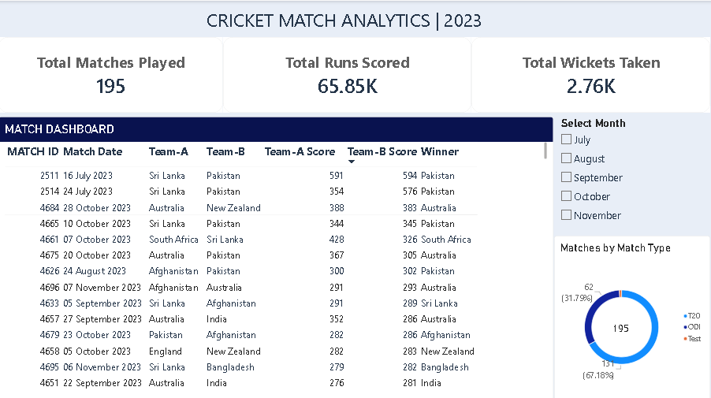
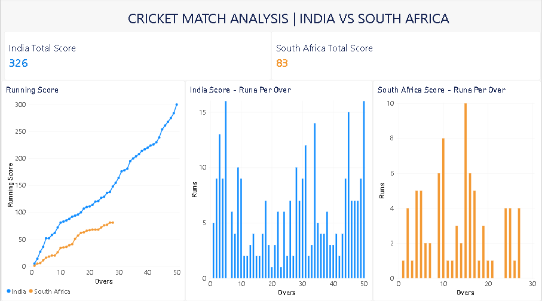

# Snowflake Cricket Analytics

## Project Overview

An end-to-end Cricket Analytics Data Engineering project designed to ingest, transform, model, and analyze structured and semi-structured cricket match data using Snowflake SQL and Microsoft Power BI.

The project implements a multi-layer data architecture to process raw JSON data into analytics-ready datasets, enabling match-level insights, team performance analysis, and statistical reporting.

## Technology Stack

- **Cloud Data Warehouse:** Snowflake
- **Query Language:** SQL
- **Data Format:** JSON
- **Data Ingestion:** Snowflake Stages and COPY INTO
- **Change Data Capture:** Snowflake Streams
- **Workflow Orchestration:** Snowflake Tasks
- **Data Transformation:** SQL, VARIANT, LATERAL FLATTEN
- **Data Modelling:** Fact and Dimension Tables
- **Data Visualization:** Microsoft Power BI

## Data Architecture

The project follows a multi-layer data architecture implemented in Snowflake:

1. **LAND Layer:** Serves as the staging and ingestion layer, storing source JSON files in Snowflake stages and maintaining file format configurations for data loading.
2. **RAW Layer:** Ingests semi-structured cricket match data into Snowflake using COPY INTO and VARIANT data types, preserving the source data structure.
3. **CLEAN Layer:** Performs JSON parsing, nested data extraction using LATERAL FLATTEN, data type conversions, and data cleansing to produce structured datasets.
4. **CONSUMPTION Layer:** Implements analytical data modelling through fact and dimension tables, providing curated datasets for downstream reporting and business intelligence.

The processed datasets are connected to Microsoft Power BI for analytical reporting and visualization.

## Key Engineering Implementations

- Configured scheduled JSON data ingestion using Snowflake Stages and COPY INTO.
- Leveraged VARIANT data types and LATERAL FLATTEN to process nested semi-structured JSON structures.
- Implemented incremental data processing using append-only Snowflake Streams.
- Automated dependent data transformation workflows using Snowflake Tasks.
- Designed fact and dimension tables to support analytical queries and relational data modelling.
- Developed Power BI dashboards for overall cricket statistics and match-level performance analysis.

## Analytics & Reporting

The Power BI dashboard provides:

- Overall cricket match statistics and performance indicators.
- Team-level performance analysis.
- Match-specific score analysis.
- Runs-per-over analysis.
- Cumulative scoring trends across overs.

## Project Objectives

- Demonstrate end-to-end data ingestion and transformation workflows.
- Implement incremental data processing using Snowflake Streams.
- Automate data pipeline execution using Snowflake Tasks.
- Apply dimensional modelling concepts through fact and dimension tables.
- Transform semi-structured JSON data into analytics-ready datasets.
- Enable data-driven cricket performance analysis through Power BI.

## Dashboard Preview

### 1. Cricket Overview Dashboard



### 2. India vs South Africa Match Analysis



## Repository Structure

```text
snowflake-cricket-analytics/
│
├── README.md
│
├── Dataset/
│   ├── 1383534.json
│   ├── 1383539.json
│   ├── 1383541.json
│   └── ... (200+ JSON files)
│
├── SQL/
│   ├── schema_creation.sql
│   ├── raw_zone.sql
│   ├── clean_zone1.sql
│   ├── clean_zone2.sql
│   ├── clean_zone3.sql
│   ├── data_pipeline.sql
│   ├── data-quality.sql
│   ├── delivery-fact.sql
│   ├── fact-dim-tables.sql
│   └── populate-fact.sql
│
├── PowerBI/
│   └── Cricket Analytics.pbix
│
└── Screenshots/
    ├── Cricket_Overview.png
    └── India_vs_South_Africa.png
```
## Author

Developed as a hands-on Data Engineering and Analytics project using Snowflake SQL and Microsoft Power BI.
